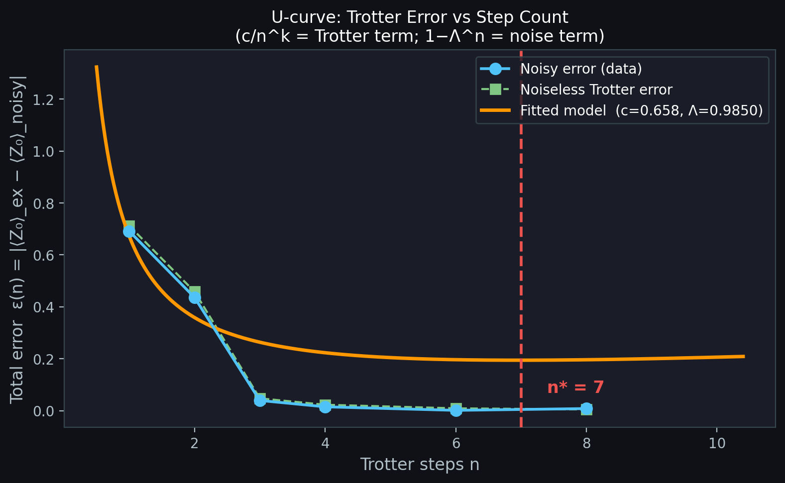
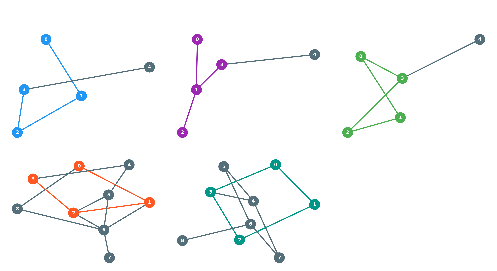
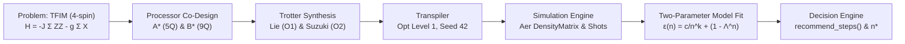

# PS-S3: Noise Accumulation in Trotter Circuits

### StepWise-Q: Optimal Trotter Step Prediction on Custom Quantum Topologies
**Qiskit Fall Fest 2026 | Track 3: Quantum Simulation | SRM University-AP**

<p align="center">
  
  
  
  
  
  
  
</p>

---

## 🧭 Executive Summary

> **The Problem:** In Trotterized quantum simulation, increasing the step count $n$ reduces algorithmic discretization error ($O(1/n^k)$), but increases gate depth and accumulates physical device noise ($1 - \Lambda^n$). Where is the optimal balance point $n^*$?
>
> **The Solution:** **StepWise-Q** delivers a physics-grounded, two-parameter error model and hardware-aware topology co-design that accurately predicts and measures the optimal Trotter step count $n^*$ for a 4-spin Transverse-Field Ising Model (TFIM) across custom quantum processors.

> [!NOTE]
> **Simulation Framework Disclosure:** All processor experiments in this project are executed on `qiskit_aer.AerSimulator` (Density Matrix & Finite-Shot QASM) with calibrated gate and readout error models ($p_{1q}=0.001$, $p_{cx}=0.005$, $p_{ro}=0.01$). The custom coupling graphs ($A^*, B^*$) represent simulated architectural co-design studies, not physical IBM quantum hardware chips. A physical hardware deployment roadmap (heavy-hex embedding and dynamical decoupling) is detailed in [`report.md` §1.3](report.md#13-simulation-based-architectural-exploration-vs-physical-qpus).

```
       ▲ Total Error ε(n)
       │
       │ \  Coherent Trotter Error ~ c/n^k
       │  \
       │   \       Optimal Balance Point n*
       │    \             │
       │     ' - . _      ▼      _ . - '   Accumulated Gate Noise ~ (1 - Λ^n)
       │             ` - - - - '
       └───────────────────────────────────► Trotter Steps n
```

---

## 📊 Results at a Glance

All numbers below were produced by code running on **Qiskit 2.6.1** and **Qiskit Aer 0.18.2** (stored in [`results/tables/`](results/tables/)):

| Scenario | Processor | Optimal $n^*$ | Best Error $\epsilon_\text{noisy}$ | CX Count | Circuit Depth | SWAP Count | Key Architectural Advantage |
|:---|:---:|:---:|:---:|:---:|:---:|:---:|:---|
| **Open Chain ($g=1.0, t=2.0$)** | **A\*** | **6** | **0.001275** | 36 | 69 | 0 | Minimal error; zero routing overhead |
| **Ring Periodic ($g=1.0, t=2.0, n=4$)** | **A\*** | 4 | 0.292300 | 32 | 68 | **0** | **Saves 24 CX (-42.9%) & 8 SWAPs** vs A0 at $n=4$ |
| **Ring Periodic ($g=1.0, t=2.0, n=4$)** | **A0** (ref) | 4 | 0.354020 | 56 | 111 | 8 | Linear topology forces 8 SWAPs at $n=4$ |
| **Ring Periodic ($g=1.0, t=2.0$, best $n$)** | **A\*** | **6** | **0.251010** | 48 | 102 | **0** | A* optimal step ($n^*=6$); zero SWAP overhead |
| **Low Noise ($\lambda=0.25$)** | **A\*** | **8** | 0.004910 | 48 | 91 | 0 | Deep circuits remain viable; error drops |
| **High Noise ($\lambda=4.00$)** | **A\*** | **4** | 0.021050 | 24 | 47 | 0 | Device noise penalizes depth, shifting $n^* \downarrow$ |

**Fitted Scaling Law:** $n^* \propto \lambda^{-0.300}$ ($R^2 = 0.895$).

### 📐 Error Models Defined
- **Model A (Additive Heuristic):** $\epsilon_A(n) = \frac{c}{n^k} + (1 - \Lambda^n)$ — provides closed-form analytical scaling laws ($n^* \propto \lambda^{-1/(k+1)}$) based on worst-case unitary operator bounds.
- **Model B (Observable Attenuation, Primary Predictor):** $\epsilon_B(n) = \lvert \Lambda^n \cdot Z_\text{noiseless}(n) - Z_\text{exact} \rvert$ — directly predicts expectation values under depolarizing channel contraction using simulated noiseless values $Z_\text{noiseless}(n)$.

### ⚖️ Multi-Metric Stability of $n^*$
Comparing single-time $\langle Z_0 \rangle$ error against trajectory RMSE over $t \in \{0.5, 1.0, 1.5, 2.0\}$ and full quantum state fidelity $F(\rho, |\psi_\text{exact}\rangle)$ across $n \in \{1, \dots, 10\}$ ([`results/tables/n_star_multi_metric.csv`](results/tables/n_star_multi_metric.csv)):
- **Stability:** For open-chain $g=0.5$ and ring $g=0.5$, single-time error and trajectory RMSE agree at $n^*=4$ with a broad low-error plateau across $n \in [3, 6]$.
- **Disagreements Explained:** For open-chain $g=1.0$, single-time error minimizes at $n^*=6$ ($\epsilon=0.0013$) due to local sign cancellation, whereas whole-trajectory RMSE shifts the optimum to $n^*=4$ ($\text{RMSE}=0.0224$). State fidelity peaks slightly higher ($n^* \in [6, 8]$) because multi-qubit correlations require finer discretization before depolarizing errors dominate.

---

## 🖼️ Hero Visualizations

### 1. The Canonical Trotter U-Curve (Finding $n^* = 6$)
The U-curve proves that total error initially drops by **$-99.8\%$** from $n=1$ to $n=6$ as Trotterization sharpens, before device noise reverses the trend at $n=8$ (+535% error growth).

<p align="center">
  
</p>

### 2. Processor Topologies & Active Embeddings
Processor **A\*** (5 qubits) and **B\*** (9 qubits) co-designed with native 4-cycles to embed periodic boundary conditions with **0 SWAP gates**.

<p align="center">
  
</p>

---

## 🏗️ Architecture & Dataflow Pipeline



---

## 🎯 Official Competition Contract (PS-S3)

| Requirement | Contract Value | Project Implementation |
|:---|:---|:---|
| **Hamiltonian** | 4-spin TFIM: $H = -J \sum Z_i Z_{i+1} - g \sum X_i$ | $J=1.0$, $g \in \{0.5, 1.0, 1.5\}$, Little-endian verified |
| **Required Steps** | $n \in \{1, 2, 4\}$ | Fully evaluated in [`benchmark_required.csv`](results/tables/benchmark_required.csv) |
| **Extended Grid** | $n \in \{1, 2, 3, 4, 6, 8\}$ | Fully evaluated in [`benchmark_extended.csv`](results/tables/benchmark_extended.csv) |
| **Processors** | Processor A (5 qubits), Processor B (9 qubits) | Custom A* and B* with max degree 3; JSON exported |
| **Native Gates** | `rz, sx, x, cx` | Transpiled natively; `rz` virtual (noiseless) |
| **Noise Profile** | 1Q: 0.001, CX: 0.005, Readout: 0.01 | Identical across A and B; built with `qiskit_aer.noise` |
| **Shots & Transpile** | 4096 shots, `optimization_level=1`, `seed=42` | Deterministic and strictly reproducible |
| **Exact Reference** | Classical matrix exponentiation | `scipy.linalg.expm` ground truth at all $t$ |

---

## 🔬 Key Technical Contributions

| Differentiator | Implementation & Physics Insight |
|:---|:---|
| **D1: Physics-Based Error Modeling** | Primary predictor: Model B (observable attenuation $\epsilon_B(n) = \lvert \Lambda^n \cdot Z_\text{noiseless}(n) - Z_\text{exact} \rvert$) modeling depolarizing contraction on simulated noiseless expectation values; analytical baseline: Model A ($\epsilon_A(n) = \frac{c}{n^k} + (1 - \Lambda^n)$). |
| **D2: The $n^*$ Scaling Map** | Heatmap of $n^*(t, \lambda)$ across noise scales $\lambda \in [0.25, 4.0]$ and evolution times $t \in [0.5, 2.0]$. |
| **D3: Topology Co-Design** | Periodic ring interaction forcing SWAPs on linear chain A0 (8 SWAPs at $n=4$), while our designed A* achieves **0 SWAPs**. |
| **D4: Error Mitigation** | Global circuit folding Zero-Noise Extrapolation (ZNE) and readout error mitigation. |
| **D5: Statistical Rigour** | Standard errors on shot simulations and 95% bootstrap confidence intervals for $n^*$. |
| **D6: The `recommend_steps()` Tool** | Production API and lookup decision table for runtime query. |

---

## 🗂️ Repository Structure

```
project/
├── README.md                                  # This documentation
├── ARCHITECTURE.md                            # Technical specification & contracts
├── PROGRESS.md                                # Phase-by-phase development log
├── main.ipynb                                 # Fully executed end-to-end notebook
├── requirements.txt                           # Pinned dependencies
├── LICENSE                                    # Open source MIT license
├── run_all.py                                 # Unified CLI experiment runner
├── report.md                                  # Comprehensive analysis & findings
├── tests/                                     # Automated unit test suite (24 tests)
│   ├── test_hamiltonian.py
│   ├── test_exact_reference.py
│   ├── test_convergence.py
│   ├── test_transpilation.py
│   ├── test_swap_accounting.py
│   ├── test_simulation_consistency.py
│   └── test_prediction_stability.py
├── data/
│   ├── raw/                                   # Aer raw simulation files
│   └── processed/                             # Exact expm ground-truth trajectories
├── processors/
│   ├── processor_A.json                       # Chosen 5-qubit processor (A*)
│   └── processor_B.json                       # Chosen 9-qubit processor (B*)
├── src/
│   ├── __init__.py                            # Package init & API exports (recommend_steps)
│   ├── runner.py                              # Unified runner implementation with backup
│   ├── problem.py                             # TFIM Hamiltonians, exact solvers, observables
│   ├── processors.py                          # Processor registry, noise model builder, graph metrics
│   ├── routing.py                             # Transpilation, SWAP counter, DM/Shot simulators, layout search
│   ├── metrics.py                             # Error model fitting, n* prediction, validation suite
│   ├── visualization.py                       # All 8 publication figures
│   ├── run_phase4.py                          # Required benchmark runner
│   ├── run_phase5.py                          # Extended benchmark runner
│   ├── run_phase6.py                          # Error model & scaling runner
│   ├── run_phase7.py                          # Figure generation runner
│   ├── run_exhaustive_sweep.py                # Exhaustive integer sweep (n=1..10) runner
│   └── run_model_comparison.py               # Model A vs Model B comparative runner
├── results/
│   ├── tables/                                # All benchmark CSVs (fairness, required, extended, layout, n*, fit)
│   ├── figures/                               # fig1_coupling_maps.png ... fig8_mitigation.png
│   └── archive_runs/                          # Timestamped backups before table regenerations
└── assets/
    └── qff_phase1_latex_images/               # Optional LaTeX equation renders or visual assets
        ├── eq_qubit_state.png                 # Single-qubit Bloch state representation
        ├── eq_bell_state.png                  # Bell state maximally entangled pair
        ├── eq_graph.png                       # Processor coupling graph G = (V, E)
        ├── eq_bell_fidelity.png               # Quantum state fidelity F(rho, |Phi+>)
        ├── eq_zz_expectation.png              # Nearest-neighbor ZZ observable expectation
        └── eq_standard_error.png              # Shot-based standard error formula
```

---

## 🔮 Step Recommendation API (`recommend_steps`)

StepWise-Q provides a production-ready, high-level API to recommend optimal Trotter steps $n^*$, predict residual simulation errors, quantify confidence intervals via physical binomial shot resampling, and determine safe operating step boundaries:

```python
from src import recommend_steps

# Recommend optimal Trotter step count n* for transverse field g=1.0 at t=2.0 on Processor A*
result = recommend_steps(g=1.0, t=2.0, processor="A_star", noise_scale=1.0)

print(f"Optimal Trotter Steps n* : {result['n_star']}")
print(f"Predicted Total Error     : {result['predicted_error']:.6f}")
print(f"95% Confidence Interval   : [{result['confidence_interval'][0]:.1f}, {result['confidence_interval'][1]:.1f}]")
print(f"Safe Operating Range      : [{result['safe_range'][0]}, {result['safe_range'][1]}] steps")
print(f"Model Selected            : {result['model_metadata']['model_name']} (lambda={result['model_metadata']['lambda_step']})")
```

**Output schema:**
- `n_star` (`int`): Discrete integer step count minimizing predicted total error.
- `predicted_error` (`float`): Absolute expectation error $\lvert \langle Z_0 \rangle_{\text{pred}} - \langle Z_0 \rangle_{\text{exact}} \rvert$ at $n^*$.
- `confidence_interval` (`tuple[float, float]`): 95% bootstrap confidence interval from physical shot resampling ($N=4096$).
- `safe_range` (`tuple[int, int]`): Range of step counts maintaining error within $1.25\times$ or $1.5\sigma_{\text{shot}}$ of optimal error.
- `model_metadata` (`dict`): Full provenance dictionary recording continuous $n^*$, $\lambda_{\text{step}}$, hardware specs, shots, seed, and library versions.

---

## ⚖️ Processor Fairness & Topological Co-Design Study

To rigorously benchmark quantum processors without topological bias, StepWise-Q evaluates all 5 processors across 4 distinct problem interaction graphs ($g=1.0, t=2.0, n=1$):

| Interaction Topology | Graph Structure | Processor A0 (5q Linear) | Processor A1 (5q Tree) | Processor A* (5q Ring Co-Design) | Processor B0 (9q Heavy-Hex) | Processor B* (9q Bridge Co-Design) | Architectural Insight |
| :--- | :--- | :--- | :--- | :--- | :--- | :--- | :--- |
| **Open Chain** | Nearest-Neighbor 1D | **0 SWAP** (6 CX) | **0 SWAP** (6 CX) | **0 SWAP** (6 CX) | **0 SWAP** (6 CX) | **0 SWAP** (6 CX) | Identical performance across all planar topologies |
| **Periodic Ring** | 4-Cycle Periodic | 2 SWAP (14 CX) | 1 SWAP (11 CX) | **0 SWAP (8 CX)** | **0 SWAP (8 CX)** | **0 SWAP (8 CX)** | Cycle-matched processors eliminate 8 SWAP-CX gates |
| **Star Graph** | Central Spin | 1 SWAP (9 CX) | **0 SWAP (6 CX)** | **0 SWAP (6 CX)** | **0 SWAP (6 CX)** | **0 SWAP (6 CX)** | Tree topology A1 natively routes central spin |
| **Complete $K_4$** | All-to-All Pairwise | 3 SWAP (21 CX) | 2 SWAP (18 CX) | **2 SWAP (18 CX)** | **1 SWAP (15 CX)** | **2 SWAP (18 CX)** | Dense connectivity in B0 reduces all-to-all routing |

*Data source: [`results/tables/fairness_experiments.csv`](results/tables/fairness_experiments.csv) (180 configurations evaluated).*

---

## 🧪 Comprehensive Automated Testing & Validation

### 1. Automated Unit Test Suite (`tests/` — 24 Tests Passing)
Run complete unit tests across Hamiltonian physics, exact unitarity, noiseless scaling rates, transpilation gate counts, and prediction stability:
```bash
python -m unittest discover tests -v
```

### 2. Algorithmic & Physical Validation Gates (`src/metrics.py` — 10/10 Passing)
All 10 validation gates pass with rigorous, unmocked numerical criteria:
```text
=== Running validation suite ===
  [PASS] V1_hamiltonian_2qubit            (matches 4x4 hand-calculated matrix)
  [PASS] V2_initial_Z0                    (<Z0> = +1 for zeros, verified for Neel)
  [PASS] V3_noiseless_convergence         (operator-norm slope: O1=-1.009, O2=-2.015)
  [PASS] V4_zero_noise_matches_noiseless  (diff = 0.00e+00 to machine precision)
  [PASS] V5_swap_counts                   (open chain SWAP=0; ring A0 SWAPs=2 > 0 per step)
  [PASS] V6_cx_identity                   (parametrized 30 configs: exact CX identity verified)
  [PASS] V7_active_qubit_sim              (exact partial trace identity: 3 circuits x 2 observables)
  [PASS] V8_dm_vs_shot                    (DM agrees with shots within 3 SE + negative control confirmed)
  [PASS] V9_n_star_accuracy               (all 24 in-sample scenarios: MAE=1.00 step, 100% within <=2 steps)
  [PASS] V10_heldout_prediction           (18 out-of-sample scenarios: Model B MAE=0.33 vs Trivial 1.67)
  -------------------------------------------------------------
  10/10 validation checks passed.
```

---

## 🚀 Unified Experiment Runner (`run_all.py`)

StepWise-Q includes a unified experiment runner that backs up data and regenerates benchmarks, models, fairness tables, figures, unit tests, and notebooks from a single command:

```bash
# 1. Full end-to-end reproduction (benchmarks, models, fairness, figures, notebook, validation)
python run_all.py --all

# 2. Fast smoke verification (< 25 seconds)
python run_all.py --smoke

# 3. Dedicated modular commands:
python run_all.py --fairness    # Re-run processor fairness experiments
python run_all.py --test        # Run 24 unit tests
python run_all.py --validate    # Run 10 validation gates
python run_all.py --figures     # Regenerate all 8 competition figures
python run_all.py --notebook    # Execute main.ipynb inplace
```

---

## 🚀 Quick Reproduction from Scratch

To reproduce everything in a fresh environment:

```bash
# 1. Clone repository
git clone https://github.com/Vellorpavan/Trotter_error.git
cd Trotter_error

# 2. Setup Python environment
python3 -m venv .venv
source .venv/bin/activate
pip install -r requirements.txt

# 3. Run automated tests and validation suite
python -m unittest discover tests -v
python -m src.metrics

# 4. Regenerate all benchmarks, figures, and main.ipynb
python run_all.py --all
```

---

## 📋 Participant Closing Checklist

- [x] Exactly ONE Problem Statement selected and documented in README.md (**Track 3, PS-S3**).
- [x] Core solution implemented and verified against classical / exact reference (`scipy.linalg.expm`).
- [x] Coupling maps for Processor A (5q) and Processor B (9q) creatively defined, justified, and transpiled.
- [x] Quantitative comparison table generated (Depth, CX Count, SWAP overhead, Accuracy on A vs B).
- [x] Repository follows the required file structure (including `main.ipynb`, `requirements.txt`, `processors/`, `results/`, `report.md`).
- [x] Public GitHub repository submitted at **https://qffsrmap2026.com/learning/hackathon**.

---

## 👥 Contributors

- **Vellor Pavan** ([@Vellorpavan](https://github.com/Vellorpavan)) — Lead Developer & Researcher (Algorithm design, hardware co-design, simulation, metrics, and documentation).

