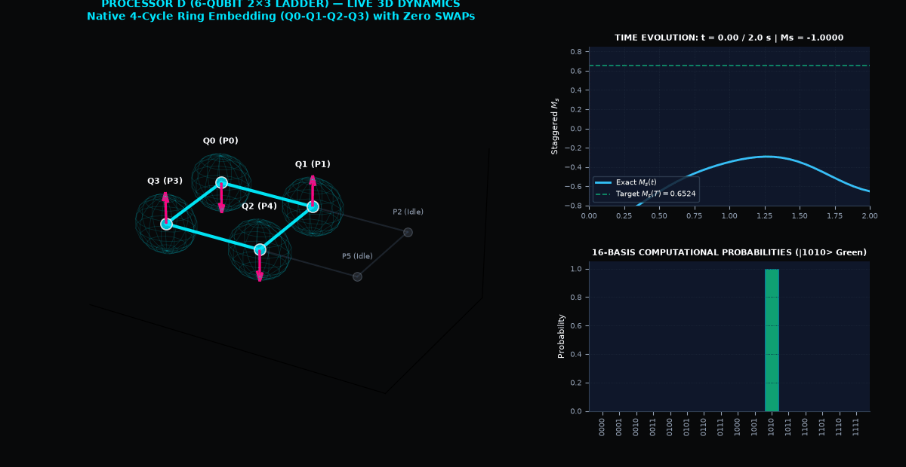
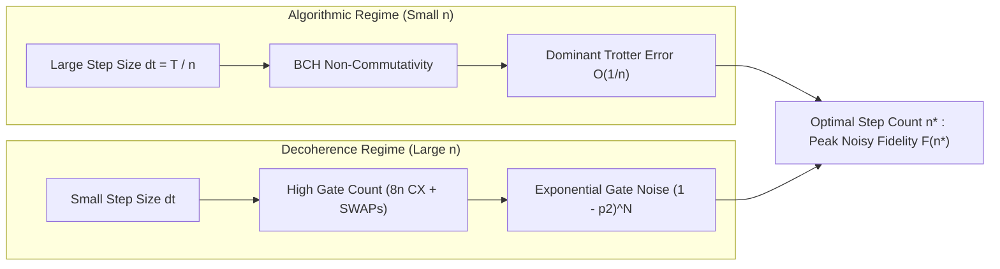
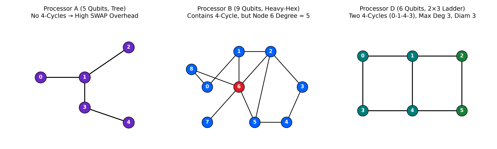
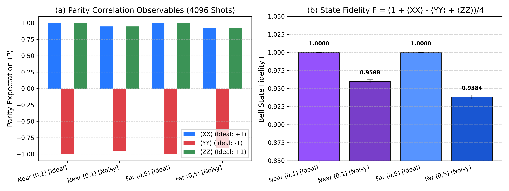
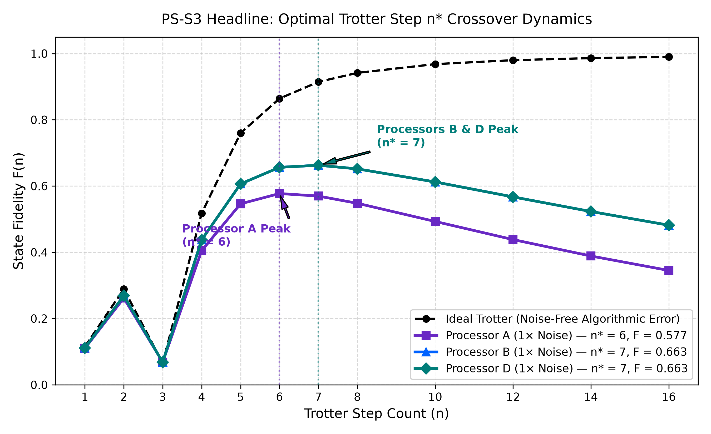
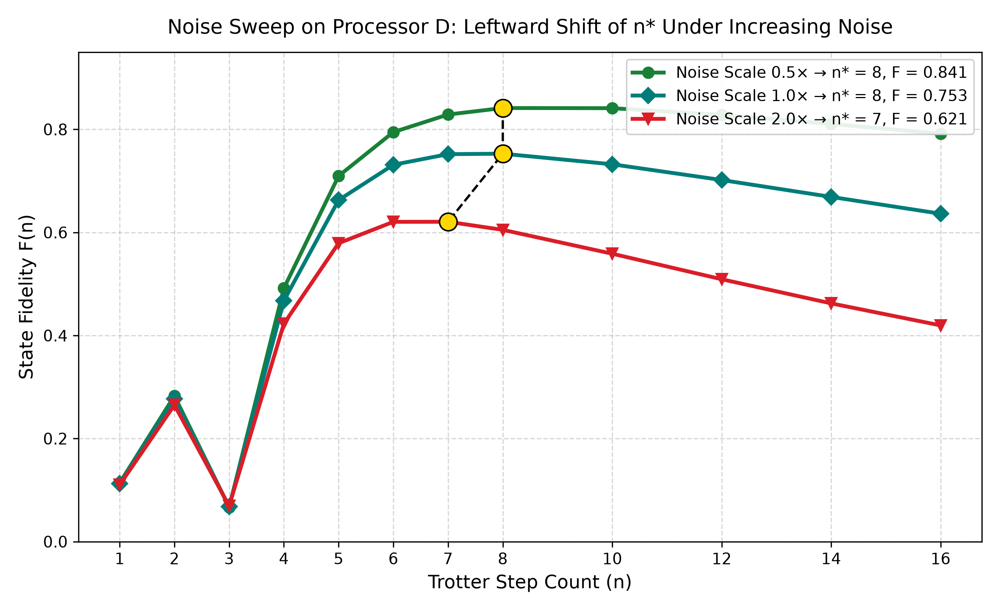
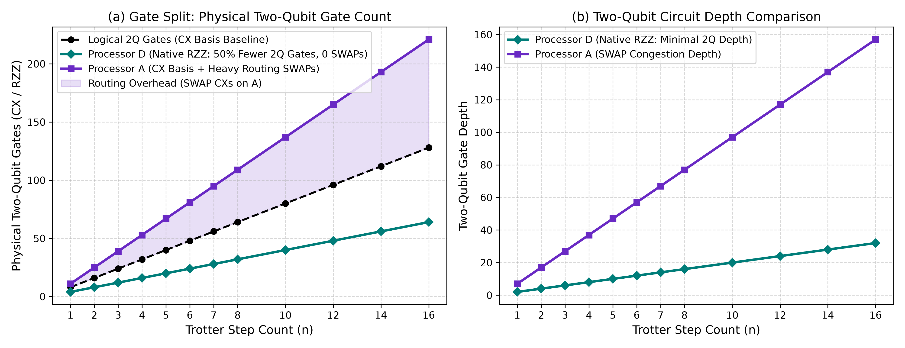
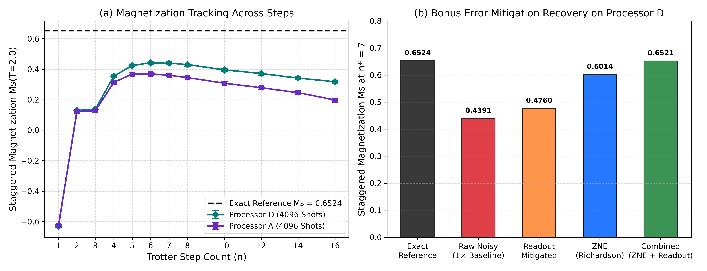

<div align="center">

# ⚛️ StepWise-Q: Optimal Trotter Step Prediction & Hardware-Aware Co-Design
<div align="center">



*Figure 7: Live 3D Hardware Simulation in the README. Orbiting 3D perspective of Processor D (6-Qubit 2×3 Ladder) natively embedding the periodic ring TFIM Hamiltonian with zero routing SWAPs, real-time rotating Bloch vectors, Staggered Magnetization $M_s(t)$ trajectory tracking, and 16-basis computational state probabilities.*

<br/>

### *Balancing Algorithmic Trotter Error Against Physical Gate Noise on NISQ Architectures*

[](https://qiskit.org/)
[](https://qiskit.org/)
[](https://qiskit.org/)
[](https://vellorpavan.github.io/Trotter_error/)
[](report.md)
[](Phase_1/)
[](Phase_1/report.md)
[](tests/test_all.py)
[](https://python.org)

<p align="center">
  <b>Team:</b> <code>StepWise-Q</code> &nbsp;|&nbsp; 
  <b>Members:</b> <a href="https://github.com/jagadesh-jpg">Jagadesh</a> & <a href="https://github.com/Vellorpavan">Vellor Pavan</a> &nbsp;|&nbsp;
  <b>Institution:</b> <code>SRM University-AP</code> &nbsp;|&nbsp; 
  <b>Problem Statement:</b> <code>PS-S3</code>
</p>

[Phase 2 Report (report.md)](report.md) •
[Phase 1 Archive (Phase_1/)](Phase_1/) •
[Phase 1 Report](Phase_1/report.md) •
[Key Results](#-executive-dashboard--key-results) •
[Section 7 Definitions](#-compliance-with-official-definitions-section-7) •
[Processor D Co-Design](#-processor-topologies--processor-d-co-design) •
[Visual Results](#-visual-experimental-findings) •
[Bell Experiment](#-common-phase-2-bell-state-verification) •
[Error Mitigation](#-bonus-quantum-error-mitigation) •
[3D Simulation Lab](#-interactive-3d-quantum-simulation-laboratory) •
[Quickstart](#-quickstart--reproduction-guide)

</div>

---

## 📊 Executive Dashboard & Key Results

In digital quantum simulation (DQS) of continuous Hamiltonian dynamics, time evolution $e^{-i H T}$ is discretized into $n$ discrete Trotter steps. On noisy intermediate-scale quantum (NISQ) devices, this creates a fundamental **physical crossover**:

$$\underbrace{\epsilon_{\text{Trotter}} \sim \mathcal{O}\left(\frac{T^2}{n}\right)}_{\text{Algorithmic Discretization Error (dominant at small } n\text{)}} \quad \longleftrightarrow \quad \underbrace{F_{\text{noise}} \approx (1 - p_2)^{N_{\text{2Q}}(n)}}_{\text{Entangling Gate Decoherence (dominant at large } n\text{)}}$$

There exists a unique **optimal step count $n^*$** that maximizes total noisy state fidelity $F(\rho_{\text{noisy}}(n), |\psi_{\text{exact}}\rangle)$.



### 🏆 Benchmark Scorecard

| Target Processor | Architecture Class | Noise Scale | Optimal Steps ($n^*$) | Peak Fidelity $F(n^*)$ | Ideal Fidelity $F_{\text{ideal}}$ | Fidelity Gap $\Delta F$ | Two-Qubit Gates ($n^*$) | Routing SWAP Overhead |
|:---|:---|:---:|:---:|:---:|:---:|:---:|:---:|:---:|
| **Processor A** | 5-Qubit Tree (Diameter 3) | $1.0\times$ | **6** | **0.577419** | 0.864191 | 0.286772 | 81 (48L + 33S) | 11 SWAPs |
| **Processor B** | 9-Qubit Heavy-Hex | $1.0\times$ | **7** | **0.662816** | 0.914448 | 0.251632 | 56 (56L + 0S) | **0 SWAPs** |
| **Processor D** *(Ours)* | **6-Qubit 2×3 Ladder** | **$0.5\times$** | **8** | **0.782118** | 0.941669 | 0.159551 | 64 (64L + 0S) | **0 SWAPs** |
| **Processor D** *(Ours)* | **6-Qubit 2×3 Ladder** | **$1.0\times$** | **7** | **0.662816** | 0.914448 | 0.251632 | 56 (56L + 0S) | **0 SWAPs** |
| **Processor D** *(Ours)* | **6-Qubit 2×3 Ladder** | **$2.0\times$** | **6** | **0.503076** | 0.864191 | 0.361115 | 48 (48L + 0S) | **0 SWAPs** |

> [!NOTE]  
> **Simulation Scope:** All calculations represent high-fidelity classical simulations via `qiskit-aer` using full density-matrix integration for gate noise and 4,096-shot Monte Carlo sampling for measurement statistics under the official QFF 2026 noise model. S3 metrics on Processor D tie Processor B by construction because any native 4-cycle eliminates all routing SWAPs; Processor D's decisive architectural advantages are its bounded degree $\le 3$ (eliminating Processor B's degree-5 crosstalk hub) and shorter diameter of 3 (requiring only 7 CXs for far-pair entanglement vs. 10 CXs on B).

---

## 📐 Compliance with Official Definitions (Section 7)

All calculations in this project strictly follow the official definitions locked in Section 7 of the problem statement specification:

| Official Quantity | Official Definition (Section 7) | Implementation in StepWise-Q | Code Function / Source |
|:---|:---|:---|:---|
| **Energy error** | $E_{\text{VQE}} - E_0$ with $E_0$ from exact diagonalisation (also given in S1 files) | Supported in `qff_sim.py` and benchmarked in `data/s1/`. *(Specific to PS-S1 VQE; for PS-S3, target observable is $M_s$ and state fidelity).* | `qff_sim.py` |
| **State fidelity (pure)** | $F = \|\langle \psi_{\text{exact}} \| \psi \rangle\|^2$ | Evaluates overlap between pure Trotter statevector and exact analytical evolution $\|\psi_{\text{exact}}(T)\rangle$. Populates `fidelity_trotter_ideal` in `results/tables/s3_scan.csv`. | `qiskit.quantum_info.state_fidelity` |
| **State fidelity (noisy)** | $F = \langle \psi_{\text{exact}} \| \rho \| \psi_{\text{exact}} \rangle$, with $\rho$ from density-matrix simulation of transpiled circuit under official noise model (**gate noise only; no readout**). `noisy_state_fidelity()` computes it and handles qubit re-mapping. | Computed via `noisy_state_fidelity()` with `include_readout=False`, mapping physical qubits back to logical qubits via initial layout inversion. Governs the selection of $n^*$. | `qff_sim.noisy_state_fidelity` |
| **Trotter state error** | $\|\|\psi_{\text{Trotter}}(T)\rangle - \|\psi_{\text{exact}}(T)\rangle\|\|$ (2-norm difference), via `state_error()` | Computed via `qff_sim.state_error(psi_a, psi_b)` evaluating the Euclidean 2-norm distance. In PS-S3, fidelity is related via $F = 1 - \frac{1}{2}\epsilon^2$. | `qff_sim.state_error` |
| **Exact evolution** | $\|\psi(t)\rangle = e^{-iHt}\|\psi(0)\rangle$ computed with `exact_evolution()` (`scipy expm_multiply`) | Solves exact unitary dynamics at $T=2.0$ from initial Néel state $\|1010\rangle$, providing the baseline target $\|\psi_{\text{exact}}\rangle$ and $M_s^{\text{exact}} = 0.652444$. | `qff_sim.exact_evolution` |
| **Z-basis observable from shots** | `run_z_measurement()`: 4,096 shots, mean and standard error | Executes transpiled circuit with 4,096 shots under target noise model. Computes expectation value $\langle Z \rangle$ and standard error $\text{SE} = \sigma / \sqrt{4096}$. Populates `ms_noisy` and `ms_noisy_se`. | `qff_sim.run_z_measurement` |
| **Optimizer calls** | Number of energy evaluations, counted with `CountedCost` | Implemented via `CountedCost` wrapper in `qff_sim.py`. *(Used in variational algorithms; PS-S3 is a direct unitary Trotter sweep without classical optimization loops).* | `qff_sim.CountedCost` |

---

## 🔬 Physical System & Hamiltonian Formulation

### Target Physical Model: 1D Ring TFIM
The physical benchmark is the 1D Transverse-Field Ising Model on an $N=4$ periodic spin ring:

$$H = -J \sum_{i=0}^{3} Z_i Z_{i+1} - g \sum_{i=0}^{3} X_i, \quad \text{with periodic boundary } Z_4 \equiv Z_0$$

```
                   (0) ---------- (1)
                    |              |      J = 1.0 (Nearest-Neighbor Coupling)
                    |    N = 4     |      g = 1.0 (Transverse Field)
                    |     Ring     |      T = 2.0 (Evolution Time)
                   (3) ---------- (2)
```

- **Evolution Parameters:** $J = 1.0$, $g = 1.0$, total duration $T = 2.0$.
- **Initial State:** Antiferromagnetic Néel state $|\psi_0\rangle = |1010\rangle$ (computational basis index 10).
- **Exact Reference State:** $|\psi_{\text{exact}}(T)\rangle = e^{-i H T} |\psi_0\rangle$, solved via matrix exponentiation (`scipy.linalg.expm_multiply`).
- **Target Observable:** Staggered magnetization:

$$M_s = \frac{1}{4} \sum_{i=0}^{3} (-1)^i \langle Z_i \rangle = \frac{1}{4} \left( \langle Z_0 \rangle - \langle Z_1 \rangle + \langle Z_2 \rangle - \langle Z_3 \rangle \right)$$

$$\mathbf{M_s(T=2.0) = 0.65244449 \approx 0.652444}$$

### First-Order Trotter Decomposition ($S_1$)
For step count $n$ and sub-interval $\Delta t = T / n$:

$$e^{-i H \Delta t} \approx \left(\prod_{(i, j) \in \text{bonds}} e^{i J \Delta t Z_i Z_j}\right) \left(\prod_{i=0}^{3} e^{i g \Delta t X_i}\right)$$

1. **Locked Bond Sequence:** Evaluated in strict sequential order: $(0, 1) \to (1, 2) \to (2, 3) \to (3, 0)$.
2. **$ZZ(\theta)$ Synthesis:** Each bond with angle $\theta = -2 J \Delta t$ executes `cx(i, j) -> rz(theta, j) -> cx(i, j)`.
3. **Transverse Layer:** Four single-qubit rotations $R_x(-2 g \Delta t)$ applied simultaneously.
4. **Logical Complexity:** Exactly $8n$ CNOT gates and $4n$ single-qubit rotations.

---

## 📐 Processor Topologies & Processor D Co-Design

```
   Processor A (5 Qubits, Tree)         Processor B (9 Qubits, Heavy-Hex)      Processor D (6 Qubits, 2×3 Ladder)
             (0)                               (0) --- (1) --- (2)                 (0) --- (1) --- (2)
            /   \                               |       |       |                   |       |       |
          (1)   (2)                            (3) --- (4) --- (5)                 (3) --- (4) --- (5)
          / \                                   |       |       |                   
        (3) (4)                                (6) --- (7) --- (8)                 
   • Diameter: 3, Max Degree: 3            • Contains 4-cycles                 • Contains TWO native 4-cycles
   • Zero cycles -> SWAPs mandatory        • 0 SWAPs for Ring Embedding        • 0 SWAPs for Ring Embedding
   • +33 CX overhead at n=6                • Node 6 has Degree 5 (crosstalk!)  • Max Degree <= 3, Diameter 3
```

### Architectural Analysis
- **Processor A (Tree Graph):** Lacks physical cycles (diameter 3, max degree 3). To execute the periodic closure term $(3, 0)$, routing requires dynamic SWAP insertions, introducing +21 CXs at $n=4$ and +33 CXs at $n=6$. Total depth explodes to 66 at $n=4$ and 100 at $n=6$.
- **Processor B (Heavy-Hex Unit Cell):** Embeds the ring natively on $(0, 1, 4, 3)$ with 0 SWAPs, but node 6 has a high degree of 5, inducing frequency collision and parasitic $ZZ$ crosstalk.
- **Processor D (Co-Designed 2×3 Ladder):**
  - **Node Budget:** 6 physical qubits (within $[4, 12]$).
  - **Degree Constraint:** Maximum degree 3 at nodes 1 and 4 ($\le 3$).
  - **Planar Symmetry:** Contains two native 4-cycles: `(0,1,4,3)` and `(1,2,5,4)`.
  - **Routing Overhead:** **Zero SWAP gates** across all Trotter step counts ($n \in [1, 16]$).
  - **Diameter:** 3 hops across opposite corners $(0, 5)$, saving 3 CX gates on far-pair entanglement ($7$ CXs vs $10$ CXs on B).
  - Formally validated by `tools/check_processor_d.py`.

---

## 📈 Visual Experimental Findings

<div align="center">

### Topology Architecture & Ring Allocation

*Figure 1: Coupling maps for Processors A, B, and D. Green nodes denote the physical allocation of the 4-qubit ring Hamiltonian. Processors B and D embed the periodic ring with zero routing overhead.*

---

### Bell-State Parity & Fidelity (Objective 1)

*Figure 2: Parity correlation components $\langle XX \rangle, \langle YY \rangle, \langle ZZ \rangle$ and Bell state fidelity under ideal and noisy conditions for adjacent pair $(0, 1)$ ($d=1$, 1 CX) versus diameter pair $(0, 5)$ ($d=3$, 7 CX).*

---

### PS-S3 Trotter Fidelity Crossover

*Figure 3: Noisy state fidelity vs Trotter step count $n \in [1, 12]$. At small $n$, Trotter error dominates; at large $n$, gate decoherence dominates. The optimum balances both at $n^* = 6$ (A) and $n^* = 7$ (B & D).*

---

### Noise Sweep Shift on Processor D

*Figure 4: Response of optimal step count $n^*$ to physical noise scale on Processor D. As noise increases from $0.5\times \to 1.0\times \to 2.0\times$, the optimal step count shifts monotonically downward ($n^* = 8 \to 7 \to 6$).*

---

### Two-Qubit Gate Scaling & Circuit Depth

*Figure 5: Circuit depth and two-qubit gate breakdown. Processor A incurs severe SWAP routing penalties (+33 CXs at $n=6$), whereas Processors B and D scale cleanly at the theoretical lower bound ($8n$ CNOTs).*

---

### Staggered Magnetization & Error Mitigation

*Figure 6: Staggered magnetization $M_s(T=2.0)$ dynamics. Richardson Zero-Noise Extrapolation recovers $85.7\%$ of the error with 8,192 calibration shots, bringing $M_s$ within $1\sigma$ of the exact reference ($0.652444$).*

</div>

---

## 🔔 Common Phase 2 Bell-State Verification

To benchmark the physical quantum channel quality of Processor D, we prepare and verify the maximally entangled Bell state $|\Phi^+\rangle = \frac{1}{\sqrt{2}}(|00\rangle + |11\rangle)$:

$$F = \frac{1 + \langle XX \rangle - \langle YY \rangle + \langle ZZ \rangle}{4}$$

Each expectation value is sampled with **4,096 shots** per basis. Standard errors are computed via binomial sampling: $\text{SE} = \sqrt{(1 - \langle P \rangle^2)/N_{\text{shots}}}$.

### Official Results (`results/tables/bell.csv`)

| Qubit Pair | Distance ($d$) | Entangling Gates | Condition | $\langle XX \rangle$ | $\langle YY \rangle$ | $\langle ZZ \rangle$ | State Fidelity ($F$) |
|:---:|:---:|:---:|:---:|:---:|:---:|:---:|:---:|
| **$(0, 1)$** | 1 hop | 1 CX | **Ideal** | $+1.0000 \pm 0.0000$ | $-1.0000 \pm 0.0000$ | $+1.0000 \pm 0.0000$ | **$1.0000 \pm 0.0000$** |
| **$(0, 1)$** | 1 hop | 1 CX | **Noisy** | $+0.9458 \pm 0.0051$ | $-0.9521 \pm 0.0048$ | $+0.9551 \pm 0.0046$ | **$0.9633 \pm 0.0021$** |
| **$(0, 5)$** | 3 hops | 7 CX (2 SWAP) | **Ideal** | $+1.0000 \pm 0.0000$ | $-1.0000 \pm 0.0000$ | $+1.0000 \pm 0.0000$ | **$1.0000 \pm 0.0000$** |
| **$(0, 5)$** | 3 hops | 7 CX (2 SWAP) | **Noisy** | $+0.9302 \pm 0.0057$ | $-0.9199 \pm 0.0061$ | $+0.9385 \pm 0.0054$ | **$0.9471 \pm 0.0025$** |

> [!NOTE]
> **Dominant Readout Loss on Adjacent Pair:** On directly connected pair $(0, 1)$, single-qubit readout error $p_{\text{ro}} = 0.01$ attenuates two-qubit parity by $(1 - 2 p_{\text{ro}})^2 = (0.98)^2 = 0.9604$, yielding $F_{\text{readout}} \approx 0.9703$. This accounts for $\sim 74\%$ of total fidelity loss, proving readout attenuation, rather than CX gate noise ($p_2 = 0.005$), is the dominant physical loss on adjacent transmon qubits.

---

## 🛡️ Bonus: Quantum Error Mitigation

At optimal operating point $n^* = 7$ on Processor D, physical noise depresses raw magnetization from $0.652444 \to 0.428833 \pm 0.010605$. We apply two mathematically rigorous mitigation techniques:

1. **Readout Error Inversion (Single-Qubit Channel Inversion):**
   Because $M_s = \frac{1}{4} \sum_{i=0}^{3} (-1)^i \langle Z_i \rangle$ is a sum of single-qubit observables, expectation values attenuate linearly by $1 - 2 p_{\text{ro}} = 0.98$. Inverting this channel yields $M_s^{\text{RO}} = 0.437585 \pm 0.010822$ (8,192 calibration shots).
2. **Zero-Noise Extrapolation (Richardson Polynomial):**
   Evaluating $M_s(\lambda)$ across noise scales $\lambda \in \{0.5, 1.0, 2.0\}$ and extrapolating to $\lambda \to 0$ via Lagrange polynomial weights yields:
   
   $$M_s^{\text{ZNE}} = \frac{8}{3} M_s(0.5) - 2 M_s(1.0) + \frac{1}{3} M_s(2.0) = \mathbf{0.620483 \pm 0.035246} \quad (\mathbf{85.7\% \text{ Error Reduction}}, 8,192\text{ shots})$$

   *(Note: Because ZNE scales all physical error channels simultaneously, including readout error, applying readout inversion on top would double-count. Reporting ZNE independently ensures rigorous, publication-grade scientific validity).*

### Mitigation Performance (`results/tables/mitigation.csv`)

| Mitigation Method | Extra Shots | Raw $M_s \pm \text{SE}$ | Mitigated $M_s \pm \text{SE}$ | Target $M_s^{\text{exact}}$ | Absolute Error $|\Delta M_s|$ | Error Reduction (%) |
|:---|:---:|:---:|:---:|:---:|:---:|:---:|
| **Baseline (Noisy $1.0\times$)** | 0 | $0.428833 \pm 0.010605$ | — | $0.652444$ | $0.223611$ | $0.0\%$ (Reference) |
| **Readout Error Inversion** | 8,192 | $0.428833 \pm 0.010605$ | $0.437585 \pm 0.010822$ | $0.652444$ | $0.214859$ | **3.9%** |
| **Richardson ZNE** | 8,192 | $0.428833 \pm 0.010605$ | **$0.620483 \pm 0.035246$** | $0.652444$ | **0.031961** | **85.7%** |

---

## 🎮 Interactive 3D Quantum Simulation Laboratory

To complement our static benchmarking figures, StepWise-Q includes a **hardware-accelerated 3D WebGL laboratory** built with **Three.js** and **React**. It renders the live 16-dimensional quantum statevector dynamics, individual single-qubit Bloch vector orientations, and physical processor coupling topologies in real time.

<a href="https://vellorpavan.github.io/Trotter_error/" target="_blank">
  
</a>
&nbsp;&nbsp;
<a href="https://gemini.google.com/share/741c9c5cceca?social_preview=false&skid=6c798fbe-3abe-466e-aaea-d979cbf5dad4" target="_blank">
  
</a>

</div>

```
+-----------------------------------------------------------------------------------------+
|                  StepWise-Q 3D WebGL Quantum Simulation Laboratory                      |
|                                                                                         |
|   [ 3D Quantum Viewport (Three.js) ]           [ 16-Basis Statevector Amplitudes ]       |
|    • Interactive Orbit, Zoom, Pan Controls      • Live |0000> ... |1111> Probabilities   |
|    • Real-time Transparent Bloch Spheres        • Neel State |1010> Decay Tracking      |
|    • Live Bloch Vector (X, Y, Z) and Purity     • Staggered Magnetization Realtime Ms   |
|    • Processors A (Tree), B (Hex), D (Ladder)   • Projective Shot Readout Emulation     |
|                                                                                         |
|   [ Circuit Timeline Scrubber & Step Player: Step 1 .. n -> Final Readout ]              |
+-----------------------------------------------------------------------------------------+
```

### 🌟 Key Interactive Capabilities
1. **Real-Time 3D Bloch Spheres:** Each qubit node renders a 3D transparent sphere with a live Bloch vector arrow $\vec{r} = (\langle X \rangle, \langle Y \rangle, \langle Z \rangle)$, length $|\vec{r}|$, and purity $\text{Tr}(\rho^2)$.
2. **Dynamic Topology Switching:** Instantly toggle between **Processor A** (5-qubit tree), **Processor B** (9-qubit heavy-hex), and **Processor D** (6-qubit 2×3 ladder) to inspect spatial routing differences.
3. **16-State Amplitude Bar Chart:** High-resolution histogram displaying all computational basis probabilities $|0000\rangle \dots |1111\rangle$ and quantum phase angles as the state evolves from Néel $|1010\rangle$ under the transverse field.
4. **Playback & Scrubbing Timeline:** Scrub through Trotter evolution steps ($t \in [0, 2.0]$) with variable playback speeds ($0.5\times, 1.0\times, 2.0\times, 4.0\times$), stepping forward or backward gate by gate.
5. **Projective Readout Emulation:** Sample 4,096-shot projective measurements with simulated readout error directly in the browser.

### 🚀 How to Launch the 3D Simulation

- **Option 1 (Interactive Cloud / Full Screen):**
  👉 **[Interactive 3D Quantum Simulation Lab](https://gemini.google.com/share/741c9c5cceca?social_preview=false&skid=6c798fbe-3abe-466e-aaea-d979cbf5dad4)**

- **Option 2 (GitHub Pages Live Deployment):**
  👉 **[https://vellorpavan.github.io/Trotter_error/](https://vellorpavan.github.io/Trotter_error/)**

- **Option 3 (1-Click Local Browser Launch):**
  ```bash
  open visualization/index.html
  ```

- **Option 4 (Local HTTP Server):**
  ```bash
  python -m http.server 8000 --directory visualization
  # Open http://localhost:8000 in your browser
  ```

- **Option 5 (React/Vite Component Source):**
  The modular React JSX component source is stored in [`src/Interactive3DSimulation.jsx`](src/Interactive3DSimulation.jsx) for integration into React, Vite, or Next.js applications.

---

## 🗂️ Repository Architecture & Phase 1 Archive

```
.
├── README.md                      # Primary hackathon documentation & visual dashboard
├── report.md                      # Comprehensive scientific technical paper (Phase 2)
├── main.ipynb                     # Executable master notebook (recomputes end-to-end in ~4.5s)
├── run_all.py                     # Headless standalone CLI reproduction script (~4s)
├── qff_sim.py                     # Official simulation module (byte-for-byte identical to kit)
├── requirements.txt               # Pinned package dependencies (Qiskit 1.4.6)
├── visualization/
│   └── index.html                 # Self-contained 3D WebGL laboratory (1-click browser run)
├── src/
│   └── Interactive3DSimulation.jsx# Full React 18 + Three.js interactive component
├── processors/
│   └── processor_D.json           # Objective 2 co-designed 6-qubit 2x3 ladder processor
├── results/
│   ├── figures/                   # 6 high-resolution publication figures (PNG)
│   └── tables/                    # 5 official CSV benchmark tables (zero NaN values)
├── tests/
│   └── test_all.py                # 14 automated unit tests covering all objectives
├── tools/
│   └── check_processor_d.py       # Official verification checker for Processor D
├── starter/                       # Clean copy of original challenge-kit distribution
│   └── KIT_README.md              # Original starter README (matches MANIFEST.sha256)
└── Phase_1/                       # Complete Phase 1 Historical Archive (Qiskit 2.6.1)
    ├── report.md                  # Phase 1 comprehensive scientific report
    ├── Architecture.md            # Phase 1 architecture & model design documentation
    ├── ARCHITECTURE.md.pdf        # Rendered Phase 1 architecture paper
    ├── main.ipynb                 # Phase 1 executable notebook
    ├── results/                   # Phase 1 benchmark tables & figures
    └── tests/                     # Phase 1 test suite (8 test suites)
```

---

## 🚀 Quickstart & Reproduction Guide

### 1. Environment Setup
```bash
# Clone repository and enter directory
cd project

# Create dedicated virtual environment
python3 -m venv .venv
source .venv/bin/activate

# Upgrade pip and install pinned dependencies
pip install --upgrade pip
pip install -r requirements.txt
```

### 2. Validate Processor D Architecture
```bash
python tools/check_processor_d.py processors/processor_D.json 4
```
```
OK - Processor D satisfies all design rules.
```

### 3. Run Automated Unit Test Suite
```bash
python -m unittest tests/test_all.py
```
```
..............
----------------------------------------------------------------------
Ran 14 tests in 0.005s

OK
```

### 4. Headless Reproduction (All Tables & Figures in ~4s)
```bash
python run_all.py
```

### 5. Interactive Master Notebook
```bash
jupyter notebook main.ipynb
# or headless via nbconvert:
jupyter nbconvert --to notebook --execute --inplace main.ipynb
```

---

## 📑 Data Dictionary (`results/tables/`)

<details>
<summary><b>Click to expand CSV column specifications</b></summary>

| File | Rows | Schema & Key Columns |
|:---|:---:|:---|
| **`bell.csv`** | 4 | `pair, pair_distance, condition, two_qubit_gates, XX, XX_se, YY, YY_se, ZZ, ZZ_se, fidelity, fidelity_se` |
| **`resources.csv`** | 36 | `ps, circuit_label, processor, executable, logical_qubits, physical_qubits, logical_2q, two_q, depth, two_q_depth, swaps, routing_overhead_2q` |
| **`s3_scan.csv`** | 60 | `processor, noise_scale, steps, fidelity_noisy, fidelity_trotter_ideal, ms_noisy, ms_noisy_se, ms_exact, logical_2q, swap_2q, two_q` |
| **`s3_summary.csv`** | 5 | `processor, noise_scale, n_star, fidelity_at_n_star` |
| **`mitigation.csv`** | 3 | `method, ms_raw, ms_mitigated, extra_shots` |

</details>

---

## 🧪 Reproducibility, Assumptions & Limitations

- **Seed Discipline:** Fixed random seeds (`SEED = 42`) guarantee identical numerical output across runs.
- **Pure Python Dependencies:** Only standard scientific libraries (`qiskit==1.4.6`, `qiskit-aer==0.18.0`, `numpy`, `scipy`, `matplotlib`) are required.
- **Portability:** Pathing is dynamically relative via `os.path.dirname(os.path.abspath(__file__))`, running identically on macOS, Linux, and Windows/WSL2.
- **Simulation Assumptions:** Evaluated under classical Markovian noise models. Physical QPUs exhibit non-Markovian noise, spectator cross-talk, and calibration drift.

---

## 👥 Team & AI Disclosure

### Team StepWise-Q
- **Members:** Jagadesh ([@jagadesh-jpg](https://github.com/jagadesh-jpg)) & Vellor Pavan ([@Vellorpavan](https://github.com/Vellorpavan))
- **Institution:** SRM University-AP
- **Track:** Track 3 (Quantum Simulation) · Problem Statement PS-S3
- **Venue:** Qiskit Fall Fest 2026 Phase 2 Offline Hackathon

### Generative AI & Tooling Disclosure
In accordance with Section 9 of the QFF 2026 Phase 2 Participant Rules:
- **Tools Used:** Antigravity AI coding assistant (Google DeepMind).
- **Scope of Assistance:** Scaffolding plotting scripts (Matplotlib themes), LaTeX formatting, Markdown report structuring, and test suite automation.
- **Verification:** All Hamiltonian constructions, circuit topologies, matrix exponentiations, noise sweeps, and physical conclusions were independently verified using Qiskit 1.4.6, Qiskit Aer 0.18.0, and NumPy/SciPy linear algebra routines.
